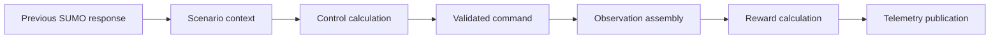

<!--
Copyright (c) 2026 Benedek Szanyó.
Copyright (c) 2026 HUN-REN SZTAKI.
All rights reserved.
-->

# Runtime, framework, and simulation architecture

This page explains how a user command becomes one managed Ray or SB3 run and
how a model plugin connects its environment. The driving model carries each environment
step through the typed SUMO boundary. Selection, execution, framework
resources and external environment access each have one owner.

## Shared framework cores and model plugins

Ray and SB3 have separate, focused runtime cores because their lifecycle APIs
are different. Model projects configure those cores with the contracts in
`lanista.reinforcengine.rl_technologies.runtime_contracts`:

- `ModelPlugin` identifies a managed runtime and fixed framework.
- `EnvironmentFactory` creates fresh model-local framework logic.
- `FrameworkRuntimeFactory` constructs a validated runtime candidate.

Shared cores own training/evaluation orchestration, checkpoint mechanics,
rolling statistics, and framework cleanup. A model plugin owns environment,
scenario/curriculum, reward, observation, and metric hooks. Shared engine code
receives domain implementations from the model plugins through shared
contracts. Automotive policy uses generic simulator ports.

## SUMO boundary

The driving environments depend on narrow lifecycle, vehicle, and
traffic-light ports. The shared SUMO controller owns the native session and
translates failures at the adapter boundary.

Required lifecycle, simulation-step, entity-read, and command failures raise a
typed simulation operation error and fail the active step. An explicitly
optional telemetry read may return a declared fallback only with quality and
error provenance. Callers must never treat a fallback as live simulator data.

Headless libsumo sessions synchronously close and can be recreated in one
process. An evaluation GUI session is process-image scoped: one selected
scenario runs once, cleanup marks the image as restart-required, and the
application root performs the replacement. The inherited intent validates and
restores the same model/framework/session/checkpoint/scenario selection. This
policy applies to the SUMO GUI adapter.

## Simulation step pipeline

The driving model executes one step through named stages:

| Stage | Product rule |
|---|---|
| Simulator input | Read required state through ports with explicit units |
| Scenario context | Classify route/intersection state and optional-read quality once |
| Control calculation | Calculate without issuing native side effects |
| Command | Validate and send the mandatory action through the adapter |
| Observation | Preserve ordered policy schema separately from diagnostics |
| Reward | Preserve component/update order and numerical compatibility |
| Telemetry | Publish stable shared metric keys and quality information |

Ray and SB3 environments adapt the final container shape and use the same
simulation pipeline. In that pipeline, the realised acceleration read at the start
of a step belongs to the preceding controller interval. The current policy
action and the command chosen for the next interval have separate roles.
