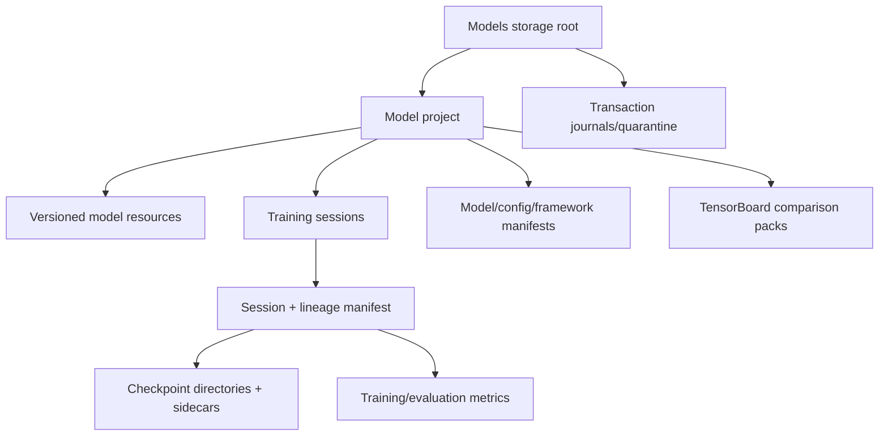

<!--
Copyright (c) 2026 Benedek Szanyó.
Copyright (c) 2026 HUN-REN SZTAKI.
All rights reserved.
-->

# Storage, metadata, and experiment data

LanistAI stores model definitions and local experiment history below a
configured models root. Persistent operations are designed around two rules:
an untrusted name never becomes an unrestricted path, and related metadata and
physical files change as one guarded use case.

## Resource and writable roots

The application ships its default settings and UI assets below
`lanista/resources/defaults/`. Set an absolute `LANISTAI_DATA_HOME` and copy
the model into it using the [installation runbook](../runbooks/installation.md).
The workspace contains runtime state, logs, the model copy and experiment
output.

```text
<data-home>/config/runtime_state.yaml
<data-home>/logs/
<data-home>/rl_model_storage/models/susan_project/
  resources/
  training_sessions/
  tensorboard/
    evaluation/libraries/
```

Inspect the resolved locations with:

```bash
python - <<'PYCODE'
from lanista.locations import get_application_paths
print(get_application_paths())
PYCODE
```

## Product hierarchy



Source resources and runtime data share a project boundary but have different
roles. Model plugin source and reviewed manifests may be versioned. Sessions,
checkpoint binaries, TensorBoard events, logs, caches, and generated plots are
mutable runtime outputs. They are not architecture sources and should not be
copied into tests.

The logical plugin namespace remains
`lanista.rl_model_storage.models.<project>...` even when the selected models
root is external. `runtime/plugin_namespace.py` prepends only the validated models root
to that package's search locations. The runtime plugin validator requires the
resolved module file to be a strict
descendant of the selected framework resource and model roots.

## Preserve evidence

Keep a checkpoint with its session and checkpoint metadata. Save a fresh
copy of the run descriptor, scenario evidence and report output when comparing
experiments. Back up a workspace after stopping the run and closing its
writers. Use the [configuration reference](../reference/configuration-and-manifests.md)
to identify metadata and the [evaluation runbook](../runbooks/evaluation-library.md)
to locate the paper-library outputs.
